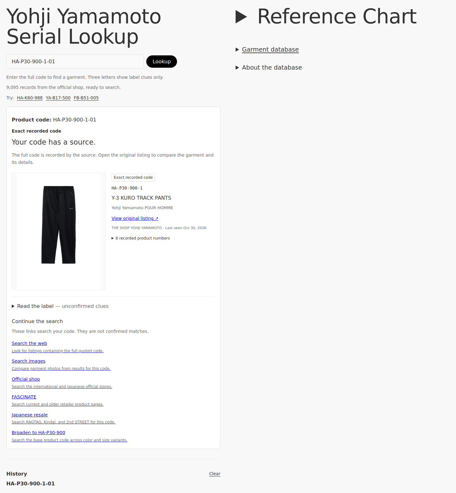

# Yohji Lookup

Find the garment behind a Yohji Yamamoto product code. Search a real catalog of source-linked garment records, browse photographs and brand lines, and continue to retailer searches when an item is missing.

This is an independent reference project. It is not affiliated with Yohji Yamamoto. The original two-column design, large sans-serif headings, gray background, black Lookup button, History, and Reference Chart are retained. The new garment database opens in the right column.



## What the lookup does

1. Normalizes the complete label code, including case, common Unicode dashes, compact core codes, and any supplied suffixes.
2. Searches the catalog for the **full base product code**. Model and material digits participate in matching.
3. Shows the garment name, photograph when available, recorded product numbers, original source, and last observation date.
4. Keeps product-code matches, exact recorded suffixes, and unconfirmed variants distinct.
5. Offers exact-code web, image, official-store, retailer, and Japanese resale searches if more research is needed.

Three-letter inputs such as `HCC` show label clues only. The app does not infer a collection year from a reused season letter or from laundry-label heuristics.

| Input | Behavior |
| --- | --- |
| `HA-P30-900` | Product-code match for the official Y-3 KURO TRACK PANTS record. |
| `HA-P30-900-1-01` | Exact recorded code, if that literal product number is in the source record. |
| `HA-P30-900-99-99` | Related base product, with the requested suffix explicitly unconfirmed. |
| `HCC` | Possible line/category clues; no garment identification. |
| A valid code absent from the catalog | “Not in this index” with source-search links. |
| Catalog fails to load | “Catalog unavailable” with retry, rather than a false missing-item result. |

Multiple records sharing a code remain visible. Saved lookups store only normalized codes in the current browser; they are checked against the current catalog again when reopened. `?code=HA-P30-900` is a shareable lookup URL.

## The data source

The official international shop publishes a public product feed:

- [Public product feed](https://theshopyohjiyamamoto.com/products.json?limit=250&page=1)
- [Example official garment listing](https://theshopyohjiyamamoto.com/products/ha-p30-900-1)
- [Example public product JSON](https://theshopyohjiyamamoto.com/products/ha-p30-900-1.json)

The snapshot imported on **October 30, 2026** contains **9,095 product/colorway records** across **6,496 distinct base style codes**. The source contains multiple Yohji Yamamoto group brand lines, as recorded by the shop. The initial import traversed 37 feed pages. The count is a snapshot, not a promise of future availability.

**This is not a complete historical archive.** It covers product records observed in the official shop feed. Older collections, deleted listings predating the first import, and garments appearing only at other retailers can be missing. Search-engine visibility does not imply inclusion in this particular catalog. There is no claim that this index authenticates a physical garment.

`coverage.complete` means the importer reached the end of the public feed during that run. It does not mean every Yohji garment ever made is indexed. Because the live feed can change while pages are fetched, its raw row count can differ from the deduplicated product count.

The app fetches its own checked-in JSON snapshot. Browser searches require no API key or cross-site catalog request. Product photographs load from the source's image URLs; the original listing remains the authority for details, stock, and pricing. No prices, stock claims, full descriptions, or inferred seasons are stored.

## Run locally

The site is plain HTML, CSS, and JavaScript modules. No production dependencies or build step are required. Serve the repository over HTTP so the browser can load modules and the JSON catalog:

```bash
python3 -m http.server 8765 --bind 127.0.0.1
```

Open `http://127.0.0.1:8765`. The same files work on GitHub Pages, including project subpaths such as `/yohji-lookup/`.

## Refresh the index

Python 3.10+ is sufficient; the importer uses only the standard library:

```bash
python3 scripts/import-catalog.py
```

The importer checks the source's `robots.txt`, requests pages sequentially with delays and timeouts, and validates product numbers from observed variant SKUs. A matching product handle can supply the color-level product code; a handle alone cannot invent a garment identity. Missing photographs remain searchable with a placeholder.

Previously observed records remain in the snapshot if a later feed no longer returns them. Their `lastSeenAt` remains unchanged. `firstSeenAt` and `lastSeenAt` are observation timestamps, not manufacturing dates or collection seasons. A failed or empty import leaves the previous snapshot intact; successful writes use an atomic replacement.

Review and commit the resulting `data/catalog.json` to publish refreshed data. Refreshing is manual; no recurring job is enabled.

For a limited development import, use a separate output file so the main snapshot remains the full source traversal:

```bash
python3 scripts/import-catalog.py --max-pages 1 --output /tmp/yohji-catalog-sample.json
```

Limited imports set `coverage.complete` to `false`.

## Verify

Pure lookup tests require Node.js 20+; importer tests require Python 3.10+:

```bash
node --test tests/lookup.test.mjs
python3 -m unittest discover -s tests -p 'test_import_catalog.py' -v
```

Browser tests check real catalog loading, exact/base/variant/absent queries, input validation, saved history, filters, pagination, mobile overflow, deep links, and failed-load recovery:

```bash
npm ci
npx playwright install chromium
npm run test:browser
```

The browser test starts and stops a local preview server. Set `TEST_BASE_URL` to test an already-running server, or `TEST_BROWSER_PATH` to use an existing Chromium executable. Screenshots are saved in the ignored `test-artifacts/` directory.

## Files

| File | Purpose |
| --- | --- |
| `index.html`, `styles.css` | Responsive lookup, record gallery, and source explanation. |
| `js/app.mjs` | Accessible rendering, loading/retry, filters, URL state, and history controls. |
| `js/lookup.mjs` | Pure normalization, match boundaries, source-search links, and validated local history. |
| `data/catalog.json` | Attributed product records and source coverage metadata. |
| `scripts/import-catalog.py` | Refreshes the index from the public official feed. |
| `tests/` | Regression coverage for identity matching, importer integrity, and browser behavior. |

Project code uses the existing MIT license. Product names, photographs, and source content retain their respective ownership; the code license does not grant rights to third-party images.
